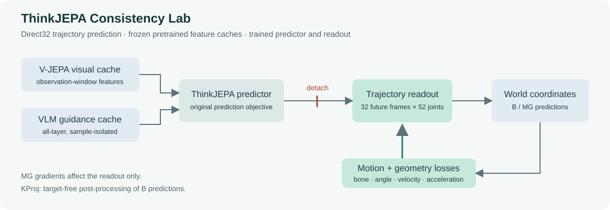
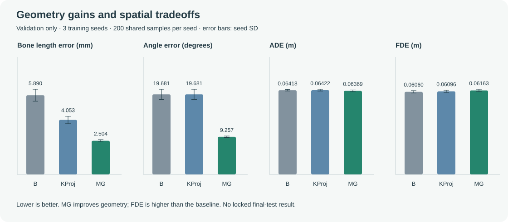

# ThinkJEPA Consistency Lab

**基于 ThinkJEPA 的运动预测复现与运动—几何一致性扩展。** 本项目研究：在相同预测设置下，轨迹读出头的骨长、关节角和动态约束，能改善哪些指标，又会付出什么代价？

> This software includes or is derived from **ThinkJEPA**, originally developed at Northeastern University, NEU SMILE LAB by Haichao Zhang and Yun Raymond Fu. Original source: [Hai-chao-Zhang/ThinkJEPA](https://github.com/Hai-chao-Zhang/ThinkJEPA). **This is an independent, modified reproduction and extension, not the official implementation.**



## 本项目做了什么

- 在缓存 V-JEPA 与 VLM 特征上训练轨迹预测模型，保留 B 与 MG 三个训练随机种子的冻结配置。
- 在世界坐标轨迹读出头加入运动—几何一致性正则；明确梯度范围，保留修正后的 guidance 和评估语义。
- 实现独立的 NumPy 评测、目标无关骨长投影 KProj 强对照，以及样本配对、三种子汇总与任务级分析工具。
- 发布逐样本指标、冻结汇总、数据划分哈希和复算入口，同时呈现改善与退化。

上游提供 ThinkJEPA 模型、训练框架、特征处理和第三方依赖；本项目的扩展、修正与版本来源见 [方法说明](docs/METHOD.md) 和 [来源说明](docs/PROVENANCE.md)。

## 验证结果

Direct32：观察 32 帧、一次预测未来 32 帧；52 个关节；训练种子 42 / 43 / 44；每模型 200 个 validation 样本、13 类任务。表中为三个训练种子的均值。**这些是本项目冻结验证结果，不是官方论文表格的直接复现成绩，也不是机器人控制成功率。**

| 指标 越低越好 | B | KProj | MG |
| --- | ---: | ---: | ---: |
| ADE m | 0.064185 | 0.064220 | 0.063693 |
| FDE m | **0.060596** | 0.060958 | 0.061635 |
| 整体骨长误差 mm | 5.890 | 4.053 | **2.504** |
| 关节角误差 ° | 19.681 | 19.681 | **9.257** |
| 速度偏差 abs log ratio | 1.425 | 1.422 | **1.232** |
| 加速度偏差 abs log ratio | 2.122 | 2.120 | **1.906** |



MG 改善几何和动态一致性；ADE 没有稳定的跨种子优势，FDE 均值存在退化。KProj 无训练即可将骨长漂移降至浮点零，并在掌骨误差等指标上有优势。不能据此声称 MG 全面优于基线。

完整均值与种子标准差见 [结果表](results/summary.csv)，逐样本证据和比较统计见 [results](results/README.md)。**locked final test 未执行**；本仓库不包含其成员清单。

## 先复算结果

Python 3.10+，无需 GPU、权重或原始数据：

```sh
git clone https://github.com/unno11/thinkjepa-consistency-lab.git
cd thinkjepa-consistency-lab
python scripts/summarize_results.py
```

该命令从归档逐样本指标重算均值和标准差，核对重复 B 的等价性及原始汇总。它不重新训练或运行模型。加入 `--write` 可重新生成 `results/summary.csv` 和复算记录。

代码与配置检查：

```sh
python -m pip install -r requirements-analysis.txt
python scripts/check_release.py
python -m unittest discover -s tests -v
```

缺少 PyTorch 时，损失、guidance 和 attention 的 13 项测试会明确跳过。完整模型测试及训练还需要 PyTorch 与上游依赖；不能把轻量检查通过当作完整 GPU 复现。

## 训练与模型评测

训练、特征准备、参数设置、checkpoint 选择和评测命令见 **[复现指南](docs/REPRODUCTION.md)**。

冻结训练设置为 1,600 个训练样本、200 个验证样本、100 epochs、四卡 DDP、每卡 batch 2。B 和 MG 都训练 predictor 与轨迹读出头；视觉及 VLM 使用缓存的预训练特征。MG 项额外作用于 readout，不更新已 detach 的 predictor 输出对应的潜表示。

本次发布恢复了冻结代码和配置、复算了结果并检查 CPU 代码，没有启动新的 GPU 训练；数据缓存、模型权重及原始训练日志不随仓库分发。

## 项目结构

```text
cache_train/        ThinkJEPA 训练路径与 MG 损失
evaluation/         Direct32、KProj、指标与比较统计
configs/            冻结的训练与评测配置
protocol/splits/    训练和验证成员清单
results/            逐样本指标、三种子汇总和复算记录
scripts/            训练编排、复算与发布检查
tests/              评测、配置、guidance 和损失检查
docs/               方法、复现、结果边界与工程案例
egodex/ vjepa2/     保留署名与许可的上游依赖
```

## 继续阅读

- [方法与梯度范围](docs/METHOD.md)
- [训练和评测复现](docs/REPRODUCTION.md)
- [结果与适用边界](docs/RESULTS_AND_LIMITATIONS.md)
- [Guidance 和评估故障案例](docs/CASE_STUDIES.md)
- [版本、改动和第三方来源](docs/PROVENANCE.md)

## 引用与许可

请引用 [ThinkJEPA 原论文](https://arxiv.org/abs/2603.22281)，保留 [NOTICE](NOTICE)、[LICENSE](LICENSE) 及第三方许可。根许可是 **LicenseRef-ThinkJEPA-Attribution**，不是标准 BSD 或 MIT；`egodex/`、`vjepa2/` 按其各自许可和通知保留。模型训练结果的边界与上游署名不因更换仓库名称而改变。

发布核验范围见 [发布核验记录](docs/VALIDATION.md)。
